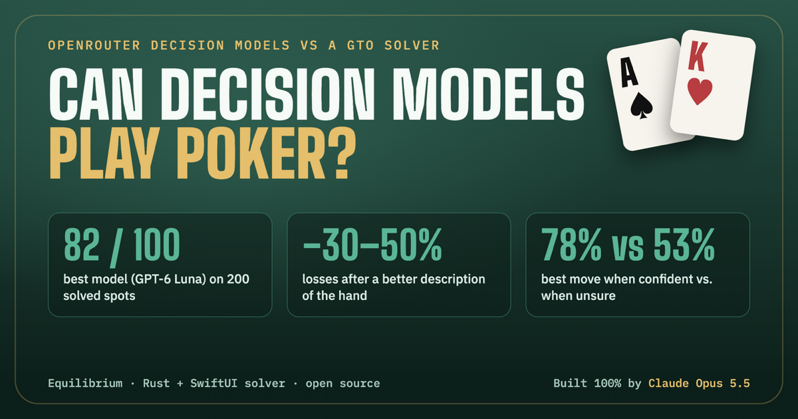
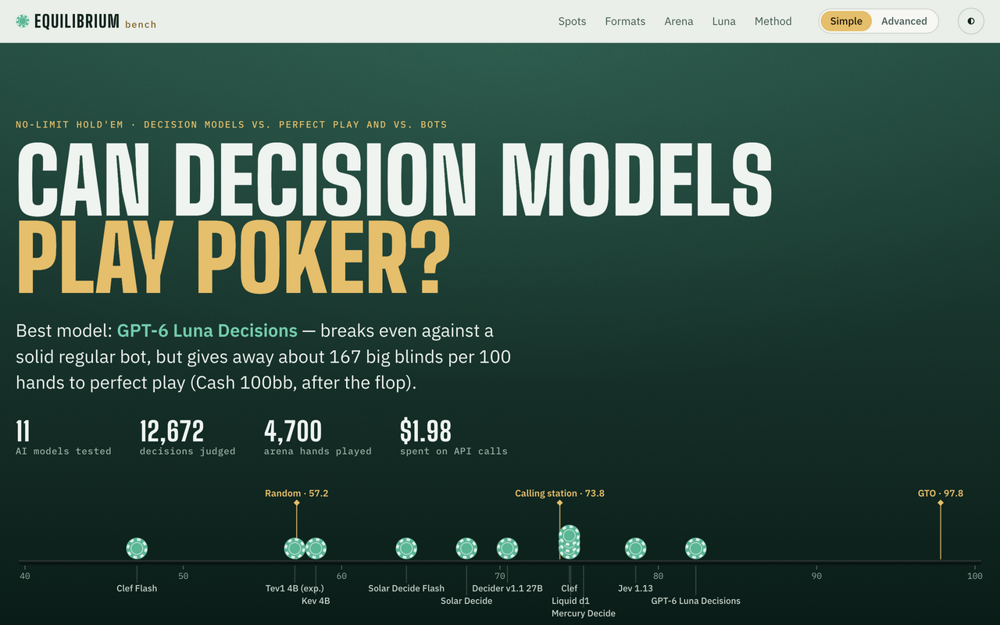
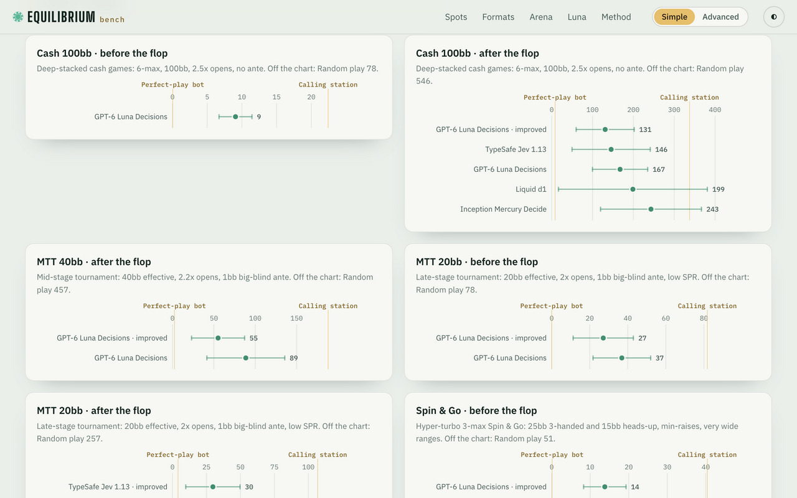
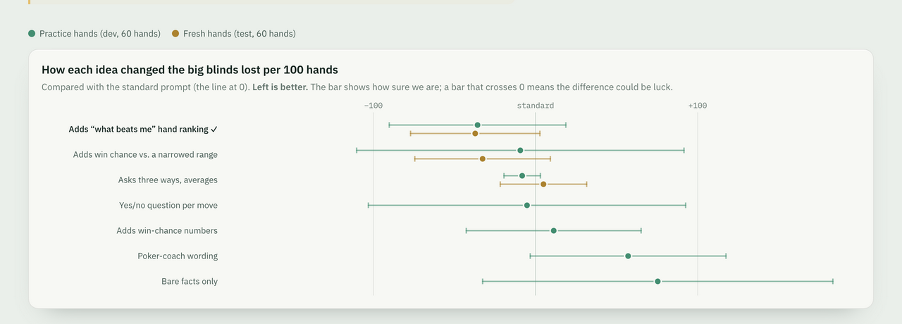

<p align="center"></p>

# Equilibrium

**Can decision models play poker?** Equilibrium is a native macOS GTO poker lab (a Rust
CFR solver with a SwiftUI workbench) plus a benchmark that puts OpenRouter's System One
[decision models](https://openrouter.ai/models?output_modalities=decisions) at the poker table:
every move they make is scored against a solved equilibrium, and they play full matches against bots.

> **Built 100% by Claude Opus 5.5 (medium effort), very vibe-coded.** Every line of code, the
> solver, the experiments, the analyses and the website were written and run by Claude Opus 5.5
> acting as orchestrator and parallel subagents. The human gave high-level direction in chat.
> See [How this was built](#how-this-was-built).

Results site: [`web/`](web/) (static, no build step). You can browse it locally, see [Results website](#results-website).

<p align="center">
  
  
</p>

## What's inside

| | |
|---|---|
| **Solver** (`core/`, `app/Sources/Solver*`) | Heads-up postflop no-limit hold'em solver in the spirit of [TexasSolver](https://github.com/bupticybee/TexasSolver): Discounted CFR over vectorised ranges in Rust, exact exploitability, suit isomorphism. There is also a heads-up preflop solver (exact push/fold Nash at 12bb or less, an open/limp/3-bet/4-bet tree when deeper). The SwiftUI workbench has a range editor, board picker, live convergence chart, strategy matrix and a per-combo EV/equity inspector. |
| **Benchmark** (`BenchKit`, `eqbench bench`) | Generates solved decisions (single spots, full hands per game format, preflop), sends each one to decision models as a structured `state` plus a `choice` question, and scores the answers by EV loss against the equilibrium. It also scores mixed-strategy EV loss, distance to the GTO mix and P(best). Prompt variants, ensembles and temperature are tuned on a dev split and confirmed on a held-out test split. |
| **Arena** (`ArenaKit`, `eqbench arena`) | Full heads-up matches (preflop to river), duplicate format, between decision models and bots (TAG regular, calling station, maniac, random). Reports bb/100, all-in EV, player stats, Bradley–Terry ratings and PokerStars-style hand histories. |
| **Results website** (`web/`) | A static, dependency-free page with hand-made SVG charts, simple and advanced modes, and a decision explorer that shows the exact request each model saw. |

## Key findings

Eleven decision models, about 20,000 judged decisions and about 38,000 arena hands (including bot reference matches). All
numbers are on the site, and `notes.json` has the full detail.

- **Best model: GPT-6 Luna Decisions.** It keeps **82 / 100** points on 200 solved turn and river spots.
  Next come TypeSafe Jev 1.13 (79), Inception Mercury Decide (75), Liquid d1 (75) and Cloudflare Clef (74).
  Sampled GTO scores 98, a calling station 74 and random play 57. In real hands Luna still gives away
  about 42–167 bb/100 to perfect play after the flop, depending on the format.
- **How you describe the hand matters as much as which model you pick.** Two extra facts about the
  hand, "how many hands beat me right now" and a win chance against the opponent's likely range,
  cut Luna's postflop losses by about **30% in cash games and 30–40% in tournaments and Spin & Go**.
  These results come from a held-out test set and are paired-significant. Preflop with short stacks,
  **one sentence of standard short-stack advice roughly halved its losses** in Spin & Go. Without it,
  Luna never went all-in preflop.
- **A cheap model can match the best one.** With the better description, Mercury Decide, at about
  a fifth of Luna's price (and also available free), went from 81 to 89 points on 300 MTT 20bb
  decisions, tying Luna's 89. In fact all five models converge: four land within one point
  (88–89/100), and Clef, which improved most, loses the fewest big blinds.
- **The models know when they're unsure.** When Luna puts more than 80% on one move, that move is
  the best one 78% of the time. When it is split 40–60%, it is best only 53% of the time, and those
  decisions cost about three times as much (n ≈ 9,500). Jev and d1 show the same pattern. Handing
  only Luna's least-confident ~5% of decisions to a second opinion trimmed its losses by 6–12%;
  escalating more than that made things worse.
- **Unanimous means reliable.** When all five top models agree (35% of spots), the pick loses only
  0.55% of the pot; when they split 3–2, the loss is eight times higher. With the plain description,
  a majority vote beat the best single model (1.99% vs 2.57%) because the models' biases cancel.
  With the better description they agree far more (65% unanimous) and voting no longer adds much.
- **Whether better play wins more money depends on the opponent.** Over ~15,000 paired full hands,
  the better description made Mercury beat an over-aggressive "maniac" bot by a further
  +275 ± 165 bb/100 (significant) but changed nothing against a solid regular (≈ +1 ± 11 over
  3,250 deals). At 20bb the short-stack advice that helped against perfect play did not
  transfer (Mercury −13 ± 12, Luna +13 ± 16). Playing a move at random by the model's own odds
  instead of its top pick cost about 31 bb/100.
- **Giving them opponent stats backfired.** Feeding the model a live summary of its opponent's
  tendencies (like a poker HUD) cost Mercury 79 ± 44 bb/100 against a calling station and did
  nothing against the solid regular: it over-adjusts rather than exploits.
- **No model reliably beats a solid regular bot in full hands.** Against the TAG bot (100bb,
  duplicate), Luna is at −21 ± 22 and Mercury at +2 ± 27 bb/100 over 1,000–2,000 hands. Every
  model beat the calling station. On identical deals the better description nudged win-rates up
  (Mercury +9.5 ± 17.7, Luna +5.7 ± 23.9 bb/100, paired) — promising but not significant.
- **Bet-sizing advice didn't help.** A third of Luna's loss is choosing the right action at the
  wrong size, but explaining what each size is for made results slightly worse, for Luna and Mercury.

## Methodology (short version)

1. **Spots.** 200 independent turn and river decisions from solved flops. Trivial spots are skipped.
2. **Full hands** (`--mode hands`). A flop is solved from each scenario's preflop ranges. Concrete
   hands are dealt and played to the end following GTO, and **every decision of both players** on
   the flop, turn and river is recorded. Reported as postflop **bb/100 lost against GTO**
   (Σ EV loss per hand ÷ 2 seats, 95% CI over hands) for four formats: cash 100bb, MTT 40bb and
   20bb with a big-blind ante, and Spin & Go (25bb 3-handed and 15bb heads-up).
3. **Preflop** (`--mode preflop`). Heads-up preflop (blind vs. blind, Spin heads-up) from the
   preflop solver.
4. **Arena.** Complete hands against bots in duplicate format (each deal is played twice with seats swapped).

**EV loss** = EV(best action) − EV(chosen action) for the exact hand against a GTO opponent. The
**score** is the average of 1 − loss / (best EV − worst EV), times 100, so 100 means always optimal. Models only ever see what a
player at the table would see. Variants must never leak solver data such as strategy, EVs, solver
equity or villain cards. Derived facts like made hand, draws, pot odds, SPR and Monte Carlo equity
against a heuristically narrowed range are allowed. Every prompt change was tuned on a dev split
and confirmed on an independent test split with paired confidence intervals. The full methodology
is in the site's advanced mode.

## Quick start

Requirements: **macOS 26+, Xcode 26+ (Swift 6), Rust stable.**

```sh
git clone https://github.com/pedrohasf/equilibrium-poker.git && cd equilibrium-poker
make run          # builds the Rust core + SwiftUI app, assembles build/Equilibrium.app and opens it
make test         # Rust + Swift tests
make bench-cli    # builds the eqbench CLI → app/.build/release/eqbench
```

The OpenRouter key is needed only for benchmark runs and arena matches against models. The
solver, scoring, bots and exports work offline. To provide it:

```sh
cp .env.example .env      # then fill in OPENROUTER_API_KEY=sk-or-...
# or: export OPENROUTER_API_KEY=sk-or-...
# or: paste it in the app's Settings (⌘,) → stored in the macOS keychain
```

`.env` is gitignored. The CLI and the app look for the nearest `.env` from the working directory upward.

### CLI tour

```sh
EQ=app/.build/release/eqbench
$EQ help                      # top level: models, bench, arena
$EQ bench help                # every benchmark subcommand
$EQ arena help                # matches, bots, ratings
$EQ bench decision-models     # live catalog with prices (API)
$EQ bench variants            # prompt/state variants (v2, nuts, shortstack, …)
$EQ arena bots                # built-in bots

# The solver on its own (no Swift needed)
cd core && cargo build --release && ./target/release/solve ../examples/toy_river.json
```

## Reproduce the benchmark

Suites and runs are stored in `~/Library/Application Support/Equilibrium/{suites,runs,arena}`. Runs
resume automatically. Every `run` prints an estimated and a running cost.

```sh
EQ=app/.build/release/eqbench

# 1. Generate solved suites (local CPU only, about 30 s per flop solve)
$EQ bench generate --decisions 200 --streets river,turn --seed 2026          # spot suite
$EQ bench generate --mode hands   --format cash  --hands 120 --seed 1        # also mtt40 | mtt20 | spin
$EQ bench generate --mode preflop --format spin  --hands 300 --seed 1
$EQ bench suites                                                             # list ids
$EQ bench split --suite <hands-suite-id>                                     # → <id>-dev / <id>-test

# 2. Bot baselines (free) and decision models (API)
$EQ bench baselines --suite <id>
$EQ bench run --suite <id> --models openai/gpt-6-luna-decisions,typesafe/jev-1.13,inception/mercury-decide,liquid/d1,cloudflare/clef
$EQ bench run --suite <id>-dev --models openai/gpt-6-luna-decisions --variant v2,nuts,eqrange,coach

# 3. Analyse (free)
$EQ bench report --suite <id>
$EQ bench compare --suite <id>-test --ref "openai/gpt-6-luna-decisions [v2]"
$EQ bench formats --published
$EQ bench synth --suite <id> temper --run "openai/gpt-6-luna-decisions [v2]" --tau 0.5,2,4,inf
$EQ bench state --suite <id> --decision d001 --variant nuts                  # exact request JSON

# 4. Arena (API for model players)
$EQ arena match --a openai/gpt-6-luna-decisions --b bot:tag --deals 100
$EQ arena leaderboard

# 5. Re-export the website data (free, no API calls)
$EQ bench export --all --no-catalog
$EQ arena export
```

The suites are seeded and the solver is deterministic. Model answers are not, so expect small
differences on a re-run.

## Results website

```sh
cd web && python3 -m http.server 8000      # http://localhost:8000  (?mode=advanced for every metric)
```

`web/` is the whole site, with no build step. The data is in `web/data/*.json` (exported by the
CLI). The prose conclusions are in `web/data/notes.json`. See [`web/README.md`](web/README.md).
`.github/workflows/pages.yml` deploys it to GitHub Pages.

<p align="center"></p>

## Repository layout

```
core/                   Rust solver (static lib + `solve` / `preflop` CLIs)
  src/solver.rs         DCFR, best response / exploitability, queries
  src/tree.rs           game tree builder (bet sizes, raise caps, all-in threshold)
  src/preflop.rs        heads-up preflop solver (push/fold Nash, open/3-bet/4-bet tree)
  src/eval.rs           7-card hand evaluator          src/range.rs   PioSolver-style ranges
  src/ffi.rs            C ABI (JSON in/out) → include/gto_core.h
app/                    Swift package (macOS 26)
  SolverKit             Swift wrapper around the core, cards, ranges, scenarios (Presets.swift)
  SolverUI              solver workbench                DesignSystem  theme + shared components
  OpenRouterKit         decisions API client, keychain/.env key handling
  BenchKit / BenchUI    suites, prompt variants, scoring, exports / benchmark lab UI
  ArenaKit / ArenaUI    heads-up match engine, bots, ratings / felt table UI
  eqbench               CLI for benchmarks, arena and exports
  Tests/SolverKitTests  Swift tests (solver, bench, arena, export)
web/                    static results site (+ data/*.json)
examples/               sample solver configs
scripts/                build-app.sh (app bundle), make-icon.sh (AppIcon.svg → .icns)
assets/                 AppIcon.svg, README banner (social.png), screenshots
```

## Limitations and caveats

- **Chip EV only.** Tournament and Spin formats ignore ICM and payout structure.
- **Heads-up only.** The postflop solves are 2-player (multiway pots are not modelled). Preflop
  suites are heads-up spots (blind vs. blind, Spin heads-up), not full 6-max preflop.
- **Approximations.** Postflop trees use a small set of bet sizes with raise caps. Solves stop at
  a target exploitability (about 0.6–0.7% of the pot on average for the published hands suites), not exact equilibrium. Deep
  preflop uses an equity-realisation model for flops instead of solving them. The preflop ranges
  that seed each scenario are hand-written, standard-looking ranges, not solver output.
- **Sample sizes.** Published suites have 50–300 hands (117–661 decisions) each, and arena
  matches have 100–400 deals. bb/100 is dominated by a few big pots, so read the confidence intervals; EV loss in % of
  the pot is the steadier metric. Arena differences between models are mostly within the margin of error.
- **GTO is a yardstick, not "winning".** Losing EV against an equilibrium is not the same as losing
  money against real opponents, as the arena results show.
- **Moving targets.** Decision models are versioned and updated by their providers. Results are
  for the versions listed on the site (October 2026).

## Cost

The whole study cost **about $4 of OpenRouter API calls**: about 84,000 model answers across
all experiments, including dead ends. The runs published on the site account for about $2. The
solver, bots, scoring and exports run locally for free. The CLI prints cost estimates before
every run.

## How this was built

This project was **100% orchestrated by Claude Opus 5.5 at medium effort, in a very vibe-coded
way.** The human gave high-level direction in chat: build a TexasSolver-style solver, benchmark the
decision models, make the tests realistic for each game format, try to make the best model better.
Claude Opus 5.5 did the rest, acting as orchestrator and spawning **parallel subagents**. It
wrote the Rust solver and its tests, the SwiftUI app, the benchmark and arena engines, the CLI,
and the website. It also designed and **ran the experiments** within an **≈ $4 API budget**:
generating suites, calling the models, reading the results and deciding the next experiment. The
loop was iterative (try a prompt variant, measure it, keep it or drop it), with every claimed
improvement **tuned on a dev split and confirmed on a held-out test split** with paired confidence
intervals. Negative results were kept and reported. Treat it as what it is: a fun, careful-ish
experiment, not peer-reviewed research. Issues and corrections are welcome.

## Credits

- [TexasSolver](https://github.com/bupticybee/TexasSolver) inspired the solver design (DCFR and
  the general workflow). Equilibrium is an independent implementation and shares no code with it.
- [OpenRouter](https://openrouter.ai) provides the System One decision models API, and the model
  providers (OpenAI, TypeSafe, Inception, Liquid AI, Cloudflare, Perplexity, Upstage, Together AI
  and others) provide the models themselves.
- Fonts on the site: Big Shoulders Display and IBM Plex (Google Fonts).

## License

[MIT](LICENSE) © 2026 Pedro Fernandes. Contributions welcome, see [CONTRIBUTING.md](CONTRIBUTING.md).
