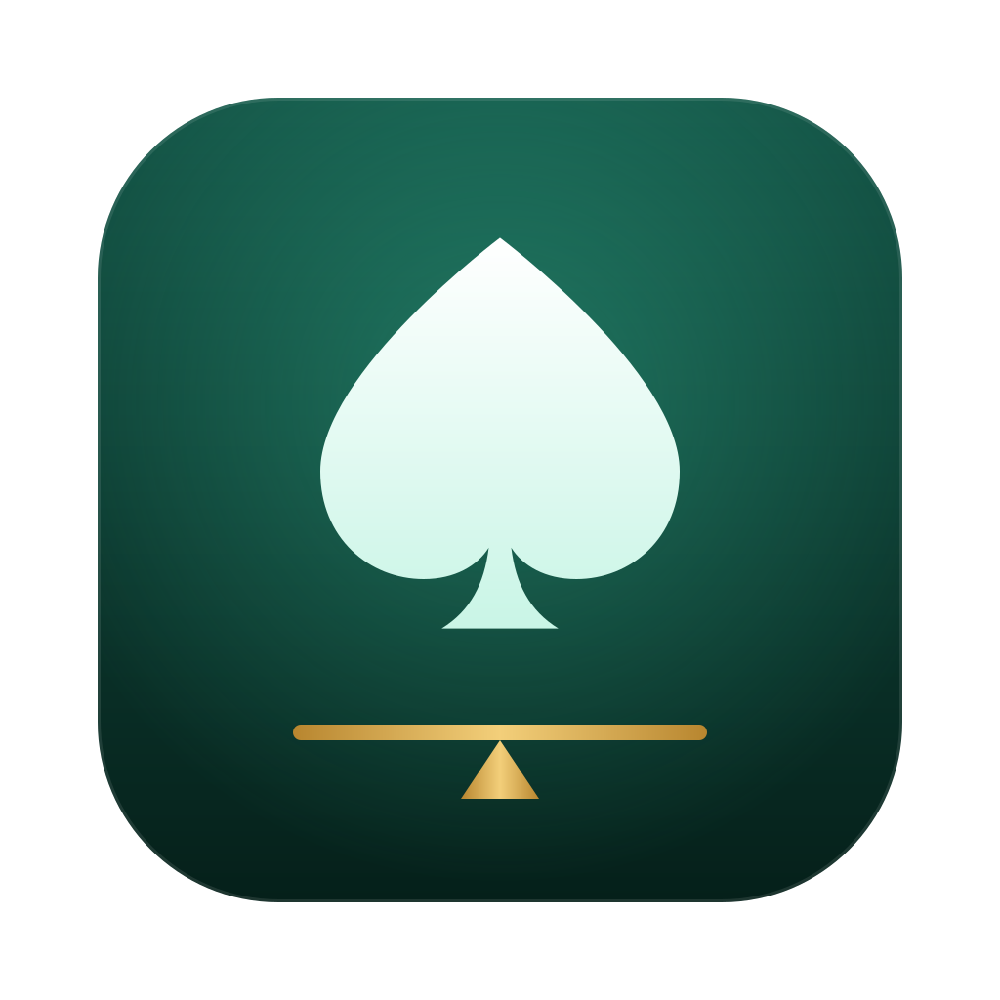

# Equilibrium

A native macOS GTO poker lab:

- **Solver** — a heads-up postflop no-limit hold'em solver in the spirit of
  [TexasSolver](https://github.com/bupticybee/TexasSolver): Discounted CFR over
  vectorised ranges, written in Rust, with a SwiftUI workbench (range editor,
  board picker, live convergence chart, GTO-Wizard-style strategy matrix,
  per-combo EV/equity inspector).
- **LLM Benchmarks** — measures how much EV language models (via
  [OpenRouter](https://openrouter.ai)) lose versus the solved equilibrium,
  decision by decision.
- **Arena** — full heads-up matches between LLMs and bots, in duplicate format,
  with bb/100, all-in-EV, player stats and hand-history replays.

## Build & run

Requirements: macOS 26+, Xcode 26+ (Swift 6), Rust (stable).

```sh
make run          # builds core + app, assembles build/Equilibrium.app, opens it
make test         # Rust + Swift tests
make bench-cli    # builds the `eqbench` command-line tool
```

Add your OpenRouter key in **Settings (⌘,)** — it is stored in the macOS
keychain — or export `OPENROUTER_API_KEY` for the CLI.

## Layout

```
core/                 Rust solver (static lib + `solve` CLI)
  src/solver.rs       DCFR, best response / exploitability, queries
  src/tree.rs         game tree builder (bet sizes, raise caps, all-in threshold)
  src/eval.rs         7-card hand evaluator
  src/range.rs        PioSolver-style range parser
  src/ffi.rs          C ABI (JSON in/out) → include/gto_core.h
app/                  Swift package
  SolverKit           Swift wrapper around the core, cards/ranges/presets
  DesignSystem        theme + shared components
  SolverUI            solver workbench
  LLMKit              OpenRouter client, keychain
  BenchKit / BenchUI  GTO EV-loss benchmark
  ArenaKit / ArenaUI  heads-up match engine & table
  eqbench             CLI for benchmarks and arena matches
examples/             sample solver configs (`core/target/release/solve examples/…`)
```

## Solver notes

- **Algorithm**: Discounted CFR (α = 1.5, β = 0.5, γ = 3) with alternating
  updates and the average strategy restarted at powers of four. Exploitability
  is measured exactly with a best-response pass and reported in % of the pot.
- **Suit isomorphism**: when suits are interchangeable (e.g. the two suits
  missing from a two-tone flop) the mirrored turn/river subtrees are solved once
  and their values permuted — 25–55% less memory and time on such boards.
- **Validated** against closed-form toy games (polarised river: bluff ⅓ of the
  betting range, call 50%) and by comparing isomorphic vs. full trees.
- Typical speeds on an M4 Pro: river spots instant, turn spots ≈0.3 s, a
  single-size flop tree (≈2.8 GB) to 0.3% pot in about a minute.

## Benchmark methodology (short)

Spots are sampled from solved turn/river subgames of standard 100bb preflop
scenarios: concrete hands are dealt from each range and the tree is walked
following GTO play until a random decision point. Each model sees the same
decisions and must pick one legal action. **EV loss** = EV(best action) −
EV(chosen action) for that exact hand, against a GTO opponent. Trivial
decisions (all actions within a small EV band) are skipped. Turn/river
subgames start from preflop ranges, an approximation documented in the app.
